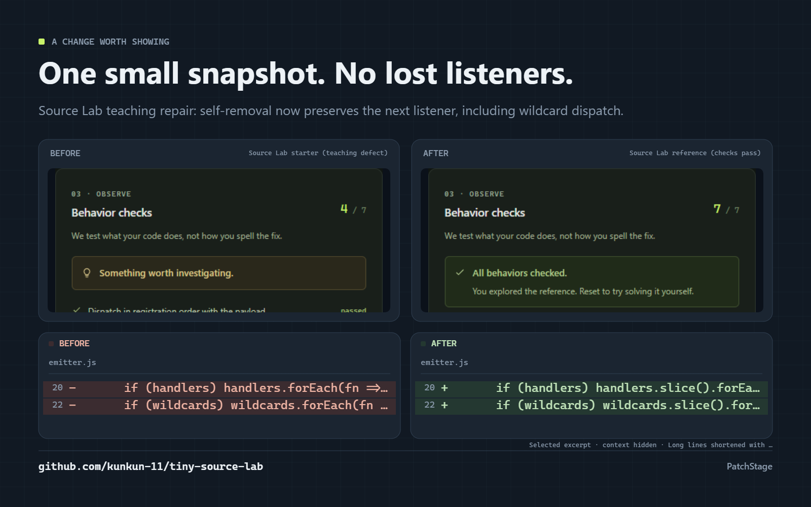

# PatchStage

**Show the change. Explain the payoff.**

Put a selected code change, your actual before/after screenshots, and a short explanation on one release card. Edit it in your browser, download the exact preview as PNG, and save an editable project for the next update.

[Try the workshop](https://kunkun-11.github.io/patchstage/) · [中文说明](README.zh-CN.md) · [Contribute](CONTRIBUTING.md)



## From a change to a shareable result

1. Paste a unified diff, such as the output of `git diff`, then select the file and hunk worth showing.
2. Write what changed and why someone would care. Add an optional repository link.
3. Supply actual before/after screenshots, or use the code-only layout.
4. Choose a landscape or square canvas, theme, and accent. Download PNG, copy a post/ALT draft, and save your editable JSON project.

No account or AI API key. No code execution. Images and edited diffs stay in your browser. Loading the included example fetches only bundled static files; exporting uses no external image service or runtime CDN.

| What you can show | Layout |
| --- | --- |
| A precise code repair | Paired before/after code with original line numbers |
| A visible UI improvement | Your two screenshot captures |
| The cause and its effect | A focused code excerpt with screenshots and an authored benefit |

Preview and PNG use the same rendered canvas. Omitted rows, hidden context, and shortened lines are identified. The image description records the selected hunk and card notes. Your screenshot proportions are preserved.

## A real example you can try

The included card shows [Tiny Source Lab](https://github.com/kunkun-11/tiny-source-lab)'s emitter experiment: a starter skips listener B when A removes itself; the reference takes a snapshot and passes the behavior checks. The screenshots are actual browser captures, and the diff comes from those two teaching implementations.

This repairs a deliberately incomplete classroom example. mitt v3.0.1 already handles the behavior. Source versions, adaptation, and image provenance are documented in [THIRD_PARTY_NOTICES.md](THIRD_PARTY_NOTICES.md).

## Run locally

Requires Node.js **20.19+** or **22.12+**; CI uses Node 22.

```sh
git clone https://github.com/kunkun-11/patchstage.git
cd patchstage
npm ci
npm run dev
```

`npm run build` outputs a static site in `dist/`; `npm run preview` serves it. Once static assets are served, authoring and export run locally. The application does not collect analytics or upload your inputs. Browser storage remembers text and settings; use **Save project** to preserve the full images in JSON.

## Supported inputs

- Standard Git/unified text diffs up to 2 MB and 30,000 lines, with multiple files/hunks, added/deleted files, rename metadata, CRLF, no-newline markers, and UTF-8/quoted filenames.
- Local PNG, JPEG, or WebP images up to 5 MB each and 40 million pixels.
- PatchStage version 1 JSON projects up to 16 MB, including embedded local image data.

Binary changes can be listed; they have no code hunk. Screenshot comparison can be used independently. Combined merge diffs require a diff against one parent. A release card presents a selected excerpt, so it should link to the full source when more context is needed. This version exports PNG and project JSON.

## Verify and contribute

```sh
npm test
npx playwright install chromium firefox
npm run test:browser
npm run build
```

Checks cover parser boundaries, project validation, real PNG pixels/dimensions, image-preserving JSON roundtrips, erroneous input, asynchronous edit preservation, and mobile/Chinese behavior. GitHub Actions runs Chromium, Firefox, and a mobile viewport before deploying Pages.

See the [contribution guide](CONTRIBUTING.md) for focused improvements. [Research](docs/RESEARCH.md) credits existing snippet, diff-story, and release-card tools; [launch material](docs/LAUNCH.md) explains one useful example to share.

If this helps explain your next release, a star makes the workshop easier to find again. MIT licensed; bundled adapted sample source retains its upstream notice.
